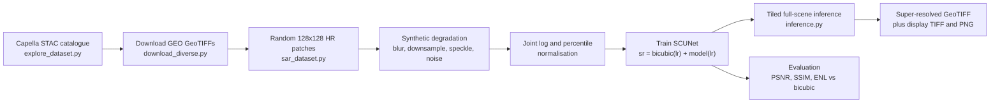

# SAR Image Super-Resolution with SCUNet

**2x super-resolution for real Capella Space X-band SAR images (64x64 to 128x128 pixels), using a Swin-Conv UNet (SCUNet) that learns to improve on bicubic upsampling, compared with SwinIR, RRDBNet and bicubic.**

[](https://github.com/dvschandraprasad/SAR-Image-enhance-using-SR-SCUNET-/actions/workflows/tests.yml)


Deep Learning course project, Master's programme in AI and Automation, University West (Högskolan Väst), Sweden, spring 2026.

## Highlights

- **End-to-end pipeline:** STAC catalogue, GeoTIFF download, on-the-fly patch sampling, synthetic SAR degradation, training, tiled full-scene GeoTIFF inference and evaluation.
- **Real satellite data:** Capella X-band Spotlight GEO images from the open dataset used in the 2026 IEEE GRSS Data Fusion Contest (1,582 catalogue items).
- **Residual SCUNet (~33 M parameters):** the network predicts only what bicubic misses, `sr = bicubic(lr) + model(lr)`. It starts as an exact bicubic upsampler.
- **SAR-aware design:** degradation with PSF blur, gamma speckle and noise on raw amplitude; joint log normalisation; ENL (speckle) metric next to PSNR and SSIM.
- **Solid training loop:** AdamW, mixed precision, gradient clipping, NaN guard, degradation curriculum, TensorBoard, resume, best-checkpoint by gain over bicubic.
- **Tested without data:** CPU smoke tests for all models and the main data helpers run in GitHub Actions.

## Results

> Checkpoints, training logs and the project report are **not** in this repository (too large). So the PSNR below **cannot be reproduced from the repository alone**. Each row says where the number comes from.

| What | Value | Source |
|---|---|---|
| SCUNet, best validation PSNR (2x, 64 to 128 px) | **~21.46 dB** at epoch 86 | **Author-reported** training run. It used different settings from the committed code (see the note below). |
| SCUNet size | 32,952,907 trainable parameters | Checked: counted on CPU, covered by a test |
| SCUNet input to output | 1x64x64 to 1x128x128 | Checked: forward pass, covered by a test |
| SCUNet at step 0 | output equals bicubic exactly | Checked: covered by a test |
| SCUNet vs SwinIR vs RRDBNet vs bicubic | PSNR, SSIM, ENL table | In the author's report (not in the repo). Make your own with `src/quick_benchmark.py` and `src/evaluate.py`. |

**Note on the 21.46 dB result.** The author reports that this run used degradation PSF sigma 0.5, 12 looks, noise std 0.003, and training with lr 1e-4, weight decay 5e-3, loss 0.8 L1 + 0.2 FFT, and MultiStepLR milestones [60, 100]. The committed `src/scunet_train.py` uses other values (lr 2e-4, weight decay 1e-5, MSE loss, milestones [30, 60, 90, 120], and a degradation curriculum). The only place "21.46 dB" appears in the code is a comment in `scunet_train.py`. No bicubic number for the same setting is in the repository. Full side-by-side table: [docs/method.md](docs/method.md#committed-config-vs-author-reported-config).

## Contents

- [Quick start](#quick-start)
- [How it works](#how-it-works)
- [Models compared](#models-compared)
- [Dataset](#dataset)
- [Installation](#installation)
- [Reproduce the pipeline](#reproduce-the-pipeline)
- [Script reference](#script-reference)
- [Project structure](#project-structure)
- [Known issues](#known-issues)
- [Limitations and future work](#limitations-and-future-work)
- [Citation and acknowledgements](#citation-and-acknowledgements)
- [Author](#author)
- [License](#license)

## Quick start

This checks that the code works. It needs **no dataset and no GPU** (about 1 minute after install).

```bash
git clone https://github.com/dvschandraprasad/SAR-Image-enhance-using-SR-SCUNET-.git
cd SAR-Image-enhance-using-SR-SCUNET-
python -m venv .venv && source .venv/bin/activate      # Windows: .venv\Scripts\Activate.ps1

pip install torch torchvision --index-url https://download.pytorch.org/whl/cpu   # CPU build is enough here
pip install -r requirements.txt pytest

pytest                        # smoke tests: models, degradation, normalisation, curriculum
python src/scunet_model.py    # prints the parameter count and a 64 -> 128 shape check
```

For training you need a CUDA GPU and the data. See [Installation](#installation) and [Reproduce the pipeline](#reproduce-the-pipeline).

## How it works



1. **Catalogue.** `explore_dataset.py` reads the Capella STAC collection for the IEEE contest and writes one metadata row per item to `data/explore_dataset.csv` (already in the repo).
2. **Download.** `download_diverse.py` picks 25 GEO scenes spread over the world and saves them to `data/samples/geotiffs/`.
3. **Patches.** `SARDataset` reads random 128x128 windows straight from the GeoTIFFs. It skips windows where less than 80% of the pixels are non-zero.
4. **Degradation.** Each HR patch becomes a 64x64 LR patch (next section).
5. **Normalisation.** `log1p`, then scale to [0, 1] with the 1st and 99th percentiles of the **HR** patch. The LR patch uses the same scale, so the real brightness difference is kept.
6. **Training.** `scunet_train.py` trains SCUNet in residual mode.
7. **Inference.** `inference.py` cuts a full scene into 64x64 tiles and writes a 2x GeoTIFF.
8. **Evaluation.** `evaluate.py` and `quick_benchmark.py` compare against bicubic.

### Degradation model

There is no real paired LR/HR SAR data, so the LR input is **simulated** from the HR image, on raw amplitude (`sar_dataset.degrade`):

```
LR = max(0,  b * (D2(G_sigma * HR) * s + n)  +  (1 - b) * D2(G_sigma * HR))

G_sigma : Gaussian PSF blur, sigma = PSF_SIGMA (HR pixels)
D2      : bicubic downsample by 2 (anti-aliased)
s       : speckle, Gamma(shape L, mean 1), clipped to [0.8, 1.25]
n       : additive Gaussian noise, std = NOISE_STD
b       : blend between noisy and clean LR, DEGRADE_BLEND
```

| Where | PSF sigma | Looks L | Noise std | Blend b |
|---|---|---|---|---|
| `sar_dataset.py` defaults (also used by `evaluate.py`, `quick_benchmark.py`, `inference.py`) | 0.20 | 40 | 0.0002 | 0.5 |
| `scunet_train.py` curriculum, epoch 1 | 0.22 | 28 | 0.00030 | 0.65 |
| `scunet_train.py` curriculum, epoch 21 | 0.18 | 40 | 0.00020 | 0.50 |
| `scunet_train.py` curriculum, epoch 41 | 0.14 | 64 | 0.00010 | 0.35 |
| `scunet_train.py` curriculum, epoch 71+ (also the fixed validation set) | 0.10 | 96 | 0.00005 | 0.25 |
| **Author-reported** run (not in the code) | 0.5 | 12 | 0.003 | not reported |

The curriculum moves **linearly** between these anchors, so the task gets easier over the epochs. Formulas, the effective blur and what each value means in practice: [docs/method.md](docs/method.md#degradation-model).

## Models compared

| Model | Code | Scale in this repo | Output | Parameters (counted) | Paper |
|---|---|---|---|---|---|
| **SCUNet** (main) | [`scunet_model.py`](src/scunet_model.py), [`scunet_train.py`](src/scunet_train.py) | 2x | residual added to bicubic | 32.95 M | Zhang et al., 2023 |
| **SwinIR** | [`swinIR_model.py`](src/swinIR_model.py), [`swinIR_train.py`](src/swinIR_train.py) | 4x only | sigmoid image | 1.20 M (embed 60, 4 x 6 blocks) | Liang et al., 2021 |
| **RRDBNet** (ESRGAN generator) | [`model.py`](src/model.py), [`train.py`](src/train.py) | 4x only | sigmoid image | 22.01 M (23 blocks) / 7.90 M (8 blocks) | Wang et al., 2018 |
| **Bicubic** | `torch.nn.functional.interpolate` | 2x | baseline | 0 | |

**About the SCUNet code.** This is the author's own **simplified re-implementation** for super-resolution, not the official SCUNet code. It is a 4-level U-Net (channels 96/192/384/768). Each Swin-Conv block splits the channels in half: one half goes through a Swin Transformer block (window attention, shifted in every second block), the other through a residual 3x3 conv block, and a linear layer merges them. A PixelShuffle head does the 2x upsampling. The model is built for 64x64 inputs. Details: [docs/method.md](docs/method.md#scunet-architecture).

**Older experiment.** [`approch_other.py`](approch_other.py) is an earlier, separate try: a 12-block RRDBNet (4x, 32 to 128 px) fine-tuned on pre-cut PNG patch pairs from **Umbra** SAR data, with optional Real-ESRGAN weights. Its input folders (`data/train/{hr,lr}`, `data/val/{hr,lr}`) came from a "step 2" script that is not in this repository. It is kept for reference only.

## Dataset

- **Source:** [Capella Space Synthetic Aperture Radar (SAR) Open Dataset](https://registry.opendata.aws/capella_opendata/), through the STAC collection made for the [2026 IEEE GRSS Data Fusion Contest](https://www.grss-ieee.org/community/technical-committees/2026-ieee-grss-data-fusion-contest/) ("SAR Temporal Storytelling"). This project only used the open data for a course project. It was **not** a contest entry.
- **Sensor:** Capella X-band SAR (about 9.6 GHz), Spotlight mode. 1,520 of the 1,582 items are HH, 62 are VV.
- **Product used:** `GEO` (geocoded, terrain-corrected, amplitude only). The scripts read band 1 as `uint16`. `SLC` items are in the catalogue but are not used.
- **Access:** public S3 bucket in `us-west-2`. No login, no API key, no AWS account.
- **License:** **[CC BY 4.0](https://creativecommons.org/licenses/by/4.0/)**. Credit Capella Space if you use or share the imagery. The MIT license of this repository covers **only the code**.
- **Size:** each GeoTIFF is large (`check_data.py` reports sizes in GB), so no imagery is stored in git.

### CSV files in `data/`

| File | What it is |
|---|---|
| `data/explore_dataset.csv` | Metadata of the contest STAC collection: 1,582 items (791 GEO + 791 SLC), all X-band Spotlight, acquired Dec 2020 to Nov 2025. 32 columns, for example `stac_id`, `product_type`, `center_lat`, `center_lon`, `polarizations`, incidence and look angles, resolution, pixel spacing, `collection_type`. All download scripts read this file. |
| `data/explore_dataset_filtered.csv` | Output of the Los Angeles filter in `explore_dataset.py`. The committed file has **only the header row**. No script reads it. |

The download scripts select rows from `explore_dataset.csv` (`product_type == 'GEO'`, sometimes a bounding box), build the STAC item URL from the date in `stac_id`, open the item with `pystac`, pick the `HH` asset (or the first asset) and stream the file with `requests`.

## Installation

Python 3.10 or newer (the notebook was last run with Python 3.13). A CUDA GPU is strongly recommended for training and needed for `cuda_test.py`.

```bash
# 1. Clone
git clone https://github.com/dvschandraprasad/SAR-Image-enhance-using-SR-SCUNET-.git
cd SAR-Image-enhance-using-SR-SCUNET-

# 2. Virtual environment
python -m venv .venv
source .venv/bin/activate          # Linux / macOS
# .venv\Scripts\Activate.ps1       # Windows PowerShell
# If PowerShell blocks the script, run first:
#   Set-ExecutionPolicy -Scope CurrentUser -ExecutionPolicy RemoteSigned

# 3. PyTorch FIRST, with the CUDA build for your GPU.
#    Copy the exact command from https://pytorch.org/get-started/locally/
pip install torch torchvision --index-url https://download.pytorch.org/whl/cu128   # example: CUDA 12.8

# 4. Everything else
pip install -r requirements.txt

# 5. (Optional) check the GPU
python src/cuda_test.py
```

`rasterio` has pre-built wheels with GDAL for most platforms. If `pip install rasterio` fails, use conda: `conda install -c conda-forge rasterio`. For the notebook, also install Jupyter (`pip install notebook`).

## Reproduce the pipeline

Run all commands from the project root, in this order. Steps 2 to 7 need the downloaded GeoTIFFs; steps 3 to 7 are much faster on a GPU.

| Step | Command | Output |
|---|---|---|
| 1. Catalogue (optional) | `python src/explore_dataset.py` | Re-queries all 1,582 STAC items. Keeps the existing `data/explore_dataset.csv`, rewrites `data/explore_dataset_filtered.csv`. Skip it: the CSV is already in the repo. |
| 2. Download data | `python src/download_diverse.py` | 25 GEO GeoTIFFs in `data/samples/geotiffs/` (many GB in total; existing files are skipped) |
| 3. Check data | `python src/check_data.py` | list of files and sizes |
| 4. Check the data pipeline | `python src/sar_dataset.py` then `python src/diagnose_dataset.py` | one LR/HR batch printed; bicubic baseline and plots in `diagnostics/` |
| 5. Train SCUNet | `python src/scunet_train.py` | `checkpoints/best_scunet.pth`, `checkpoints/scunet_epochXXX.pth`, TensorBoard logs in `runs/` |
| 6. Watch training | `tensorboard --logdir runs` | loss, PSNR, SSIM and gain over bicubic per epoch |
| 7. Evaluate | `python src/evaluate.py --save_images 8 --plot_losses` | PSNR / SSIM / ENL summary vs bicubic; images in `eval_images/`; `diagnostics/loss_curve.png` |
| 8. Compare models | `python src/quick_benchmark.py --models scunet bicubic` | PSNR, SSIM and ms/patch table (add `swinir rrdb` if you have those checkpoints) |
| 9. Super-resolve a scene | `python src/inference.py --input data/samples/geotiffs/<SCENE>.tif --use_raw_lr` | `<SCENE>_SR.tif`, `<SCENE>_SR_display.tif`, `<SCENE>_SR_preview.png` |

Notes:

- Step 5 runs the **committed** config. To try the author-reported setting, edit `CFG`, the curriculum in `src/scunet_train.py` and the degradation constants in `src/sar_dataset.py` **and** `src/inference.py`, using the [side-by-side table](docs/method.md#committed-config-vs-author-reported-config).
- In step 9, `--use_raw_lr` enlarges the real image 2x with correct georeferencing. Without it, the scene is first degraded to half size and then restored (useful to see what the model does), but the output georeferencing is wrong. See [Known issues](#known-issues).
- Patches are random, the train/validation split is by patch (not by scene), and `download_diverse.py` depends on the current STAC catalogue. Expect small differences between runs.

## Script reference

All scripts in `src/` build their default paths from their own location (`src/../data`, `src/../checkpoints`, ...). Exceptions: `approch_other.py` and `evaluate.py --image_out_dir` use the current folder. Settings that are not command-line options are constants at the top of each file.

<details>
<summary><b>Data preparation</b></summary>

| Script | What it does |
|---|---|
| `src/explore_dataset.py` | Reads the contest STAC collection with 20 threads and writes `data/explore_dataset.csv` (only if the file does not exist). Then filters to Los Angeles and writes `data/explore_dataset_filtered.csv`. |
| `notebooks/STAC_to_CSV.ipynb` | Notebook version of the same query. Writes `Capella_IEEE_DataContest_2026.csv` in the working folder. See [Known issues](#known-issues). |
| `src/download_diverse.py` | **Main download script.** One GEO scene per occupied cell of a 10x10 lat/lon grid over the data, then random scenes until there are `N_IMAGES = 25` (seed 42). Saves to `data/samples/geotiffs/`. |
| `src/download_geotiff_la.py` | Downloads one Los Angeles GEO scene into `data/samples/geotiffs/`, prints `rasterio` metadata and saves `data/samples/geotiff_preview.png`. |
| `src/download_samples.py` | Downloads the thumbnails of the 4 GEO scenes over Los Angeles to `data/samples/thumbnails/`. |
| `src/inspect_thumbnails.py` | Shows those thumbnails in a 2x2 grid. |
| `src/check_data.py` | Lists the GeoTIFFs in `data/samples/geotiffs/` with sizes in GB. |

</details>

<details>
<summary><b>Degradation and data checks</b></summary>

| Script | What it does |
|---|---|
| `src/sar_dataset.py` | `SARDataset`, `degrade` and `normalize_joint` used in training. Run directly for a one-batch check. |
| `src/diagnose_dataset.py` | Bicubic PSNR/SSIM, mean-prediction floor, LR/HR correlation and histograms on 256 px patches. Saves `diagnostics/lr_hr_pairs.png` and `diagnostics/distributions.png`. |
| `src/degradation.py` | Preview of an **older 4x** degradation on 16 patches of one LA scene. Needs `CAPELLA_C13_SP_GEO_HH_20250830031430_20250830031509.tif` from `download_geotiff_la.py`. Saves `data/samples/degradation_preview/degradation_preview.png`. |

</details>

<details>
<summary><b>Training</b></summary>

| Script | Model | Main settings (`CFG` in the file) | Saves |
|---|---|---|---|
| `src/scunet_train.py` | SCUNet, 2x, residual | patch 128, batch 4, 100 epochs, AdamW lr 2e-4, wd 1e-5, MultiStepLR [30,60,90,120] x0.5, grad clip 1.0, AMP, MSE loss, curriculum, seed 42. `'resume': True` continues from the last periodic checkpoint. | `checkpoints/best_scunet.pth` (best gain over bicubic), `checkpoints/scunet_epochXXX.pth` every 10 epochs, `runs/scunet-128patch-2x-v17-progressive-ease` |
| `src/swinIR_train.py` | SwinIR, 4x | patch 256, batch 4, 100 epochs, AdamW lr 2e-4, wd 5e-3, milestones [70,90], 0.8 L1 + 0.2 FFT | `checkpoints/best_swinir.pth` |
| `src/train.py` | RRDBNet, 4x, 23 blocks | patch 256, batch 8, 100 epochs, Adam lr 1e-4, milestones [50,75,90], 0.8 L1 + 0.2 FFT | `checkpoints/best_model.pth` |
| `approch_other.py` | 12-block RRDBNet, 4x (Umbra) | 30 epochs, Adam lr 1e-4, cosine schedule, L1 loss; downloads Real-ESRGAN and VGG19 weights on first run | `checkpoints/rrdb_sar_best_v2.pth` |

> `swinIR_train.py` and `train.py` currently **crash**: they expect 4x data but `sar_dataset.SCALE_FACTOR = 2`. Set it to 4 before retraining them. See [Known issues](#known-issues).

</details>

<details>
<summary><b>Inference: <code>src/inference.py</code></b></summary>

Full-scene SCUNet inference with 64x64 LR tiles (128x128 SR tiles).

| Option | Default | Meaning |
|---|---|---|
| `--input` | `data/samples` | One `.tif`/`.tiff` file, or a folder (searched recursively) |
| `--output` | `<input>_SR.tif` (file) or `<input>_SR/` (folder) | Output path |
| `--checkpoint` | `checkpoints/best_scunet.pth` | SCUNet weights |
| `--use_raw_lr` | off | Use the input as the LR image (no synthetic degradation) |
| `--batch_size` | 32 | Tiles per batch |
| `--smooth_sigma` | 0.0 | Gaussian smoothing after SR, in SR pixels (0 = off) |
| `--very_smooth` | off | Sets `--smooth_sigma 1.8` |
| `--no_preview_png` | off | Do not write `<name>_SR_preview.png` |
| `--no_display_tiff` | off | Do not write `<name>_SR_display.tif` |

For each scene it writes a `uint16` GeoTIFF (LZW, tiled, pixel size halved, CRS kept), a contrast-stretched display GeoTIFF and a PNG preview.

</details>

<details>
<summary><b>Evaluation and diagnostics</b></summary>

| Script | What it does | Options (defaults) |
|---|---|---|
| `src/evaluate.py` | SCUNet vs bicubic on random patches: PSNR, SSIM, gain, ENL of SR and HR. Optional 4-panel images (LR / bicubic / SR / HR) and a loss plot from TensorBoard. | `--checkpoint`, `--data_dir`, `--patches_per_image 200`, `--max_samples 2000` (0 = all), `--batch_size 16`, `--workers 4`, `--save_images 0`, `--image_out_dir eval_images`, `--plot_losses`, `--plot_losses_only`, `--run_dir`, `--loss_plot_out diagnostics/loss_curve.png`, `--loss_smooth_window 1` |
| `src/quick_benchmark.py` | SCUNet, SwinIR, RRDBNet and bicubic: PSNR, SSIM and ms/patch. Skips a model whose checkpoint is missing. | `--models scunet swinir rrdb bicubic`, `--data_dir`, `--scunet_checkpoint`, `--swinir_checkpoint`, `--rrdb_checkpoint`, `--rrdb_blocks 23` (falls back to 8), `--patches_per_image 20`, `--max_images 6`, `--max_samples 240`, `--batch_size 16`, `--workers 2`, `--warmup_batches 2`, `--timed_batches 8`, `--seed 42` |
| `src/diagnose_scunet_histogram.py` | Value histograms and per-patch mean/std of SCUNet, bicubic and HR. Saves two PNGs to `diagnostics/`. | `--checkpoint`, `--data_dir`, `--out_dir`, `--patches_per_image 120`, `--max_samples 1200`, `--batch_size 16`, `--workers 0`, `--bins 100`, `--seed 42` |

Metric definitions (PSNR, SSIM, ENL): [docs/method.md](docs/method.md#metrics).

</details>

<details>
<summary><b>Utilities</b></summary>

| Script | What it does |
|---|---|
| `src/cuda_test.py` | Prints whether CUDA is available and the GPU name (fails without an NVIDIA GPU). |
| `src/scunet_model.py`, `src/swinIR_model.py`, `src/model.py` | Model code. Run directly for a shape check on random input (CPU is fine). |
| `src/main.py` | Placeholder: one comment about the Windows PowerShell execution policy. |

</details>

## Project structure

```
SAR-Image-enhance-using-SR-SCUNET-/
├── README.md
├── LICENSE                      MIT (code only)
├── CHANGELOG.md
├── CONTRIBUTING.md
├── requirements.txt
├── pytest.ini
├── .gitignore
├── .github/workflows/tests.yml  CI: CPU smoke tests
├── approch_other.py             older RRDB experiment on Umbra PNG patches
├── data/
│   ├── explore_dataset.csv      STAC metadata (1,582 items)
│   └── explore_dataset_filtered.csv
├── docs/
│   └── method.md                technical notes and full list of known issues
├── notebooks/
│   └── STAC_to_CSV.ipynb        catalogue query notebook
├── tests/
│   ├── conftest.py
│   └── test_smoke.py            no data, no GPU needed
└── src/
    ├── explore_dataset.py       STAC to CSV
    ├── download_diverse.py      main GeoTIFF downloader (25 scenes)
    ├── download_geotiff_la.py   one LA scene + preview
    ├── download_samples.py      LA thumbnails
    ├── inspect_thumbnails.py
    ├── check_data.py
    ├── sar_dataset.py           dataset, degradation, joint normalisation
    ├── diagnose_dataset.py
    ├── degradation.py           older 4x degradation preview
    ├── scunet_model.py          SCUNet (main model)
    ├── scunet_train.py          SCUNet training (2x)
    ├── swinIR_model.py          SwinIR (4x)
    ├── swinIR_train.py
    ├── model.py                 RRDBNet (4x)
    ├── train.py                 RRDBNet training
    ├── inference.py             full-scene tiled GeoTIFF inference
    ├── evaluate.py              PSNR / SSIM / ENL vs bicubic
    ├── quick_benchmark.py       multi-model comparison
    ├── diagnose_scunet_histogram.py
    ├── cuda_test.py
    └── main.py                  placeholder

Created when you run the scripts (ignored by git):
    data/samples/   data/samples_SR/   checkpoints/   runs/   diagnostics/   eval_images/
```

## Known issues

The original program logic is kept unchanged, so these are documented, not fixed. Full list with details: [docs/method.md](docs/method.md#known-issues).

- **Reported result vs committed code.** The settings of the 21.46 dB run are not the settings in the committed code (see [Results](#results)).
- **Baseline training scripts crash.** `train.py` and `swinIR_train.py` expect 4x data, but `sar_dataset.SCALE_FACTOR = 2`.
- **Benchmark is approximate.** SwinIR and RRDBNet are 4x models; `quick_benchmark.py` resizes their output to the 2x target, and each model is scored on different random patches.
- **Default inference georeferencing.** Without `--use_raw_lr`, the pixel size is halved but the pixel count is not doubled, so the GeoTIFF footprint is wrong.
- **Different degradation in evaluation.** `evaluate.py` uses the module defaults, not the final curriculum stage used for validation during training.
- **Small data issues.** `data/explore_dataset_filtered.csv` is header-only; the notebook misses an import (use `explore_dataset.py`).

## Limitations and future work

**Limitations**

- **Synthetic degradation only.** The model learns to undo *this* simulated blur and speckle. Real low-resolution SAR may look different.
- **No real paired test set and no scene-level split.** Validation patches come from the training scenes, which can overestimate performance on new scenes.
- **Metrics on normalised patches.** PSNR, SSIM and ENL are computed after per-patch log and percentile scaling, so absolute radiometry is not measured.
- **Results depend strongly on the degradation settings.** Numbers from different settings cannot be compared directly.

**Future work**

- Use real multi-resolution pairs (the same site imaged at different Capella resolutions).
- Split by scene and region, and keep a held-out test set.
- Retrain SwinIR and RRDBNet at 2x on the same data for a fair comparison.
- Overlapping tiles with blending at inference time.
- SAR-aware losses and metrics (edge preservation, speckle-aware losses, no-reference quality).
- Publish checkpoints (GitHub Release or Hugging Face Hub) and the project report.
- Move hard-coded settings into a config file or command-line options.

## Citation and acknowledgements

**Data**

- Capella Space, *Capella Space Synthetic Aperture Radar (SAR) Open Dataset*, CC BY 4.0. https://registry.opendata.aws/capella_opendata/
- IEEE GRSS Image Analysis and Data Fusion Technical Committee and Capella Space, *2026 IEEE GRSS Data Fusion Contest: SAR Temporal Storytelling*. https://www.grss-ieee.org/community/technical-committees/2026-ieee-grss-data-fusion-contest/

Thanks to Capella Space for releasing the data, and to the IEEE Geoscience and Remote Sensing Society for organising the contest.

**Models and methods**

- K. Zhang, Y. Li, J. Liang, J. Cao, Y. Zhang, H. Tang, D.-P. Fan, R. Timofte, L. Van Gool. *Practical Blind Image Denoising via Swin-Conv-UNet and Data Synthesis.* Machine Intelligence Research, 2023. arXiv:2203.16921.
- J. Liang, J. Cao, G. Sun, K. Zhang, L. Van Gool, R. Timofte. *SwinIR: Image Restoration Using Swin Transformer.* ICCV Workshops, 2021. arXiv:2108.10257.
- X. Wang, K. Yu, S. Wu, J. Gu, Y. Liu, C. Dong, Y. Qiao, C. C. Loy. *ESRGAN: Enhanced Super-Resolution Generative Adversarial Networks.* ECCV Workshops, 2018. arXiv:1809.00219.
- X. Wang, L. Xie, C. Dong, Y. Shan. *Real-ESRGAN: Training Real-World Blind Super-Resolution with Pure Synthetic Data.* ICCV Workshops, 2021. arXiv:2107.10833. (Weights used only in `approch_other.py`.)
- Z. Liu et al. *Swin Transformer: Hierarchical Vision Transformer using Shifted Windows.* ICCV, 2021. arXiv:2103.14030.

If you use this code, please cite this repository:

```bibtex
@misc{morla2026sarscunet,
  author       = {Morla, Devi Venkata Sai Chandra Prasad},
  title        = {SAR Image Super-Resolution with SCUNet},
  year         = {2026},
  howpublished = {\url{https://github.com/dvschandraprasad/SAR-Image-enhance-using-SR-SCUNET-}},
  note         = {Deep Learning course project, University West, Sweden}
}
```

## Author

**Devi Venkata Sai Chandra Prasad Morla**
Master's student in AI and Automation, University West (Högskolan Väst), Trollhättan, Sweden
GitHub: [@dvschandraprasad](https://github.com/dvschandraprasad)

## License

The **code** is released under the [MIT License](LICENSE).

The **Capella Space SAR data** is **not** covered by this license. It is licensed under [CC BY 4.0](https://creativecommons.org/licenses/by/4.0/) and needs attribution to Capella Space. The original SCUNet, SwinIR, ESRGAN and Real-ESRGAN works have their own licenses.
